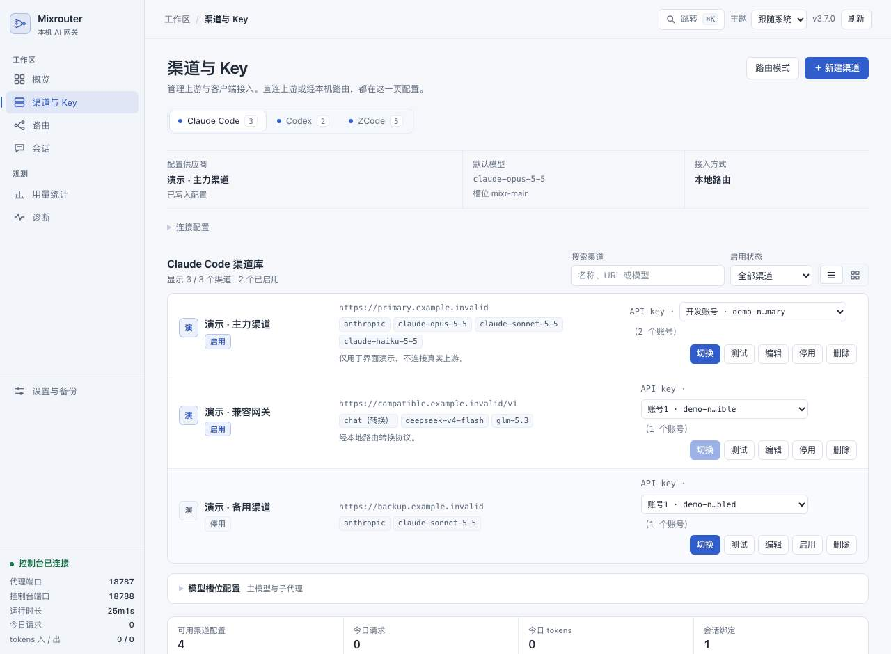

# Mixrouter

[](https://github.com/yange0793-dot/mixrouter-oss/actions/workflows/ci.yml)
[](https://github.com/yange0793-dot/mixrouter-oss/releases)
[](LICENSE)
[](package.json)

本机单用户的模型路由器:一个零依赖的 Node 进程同时服务 Anthropic 与 OpenAI 两套协议,
按模型名和会话身份把请求分发到你配置的渠道,并提供一个只绑回环地址的浏览器控制台。

[English](README.en.md)

> 定位是**本机单用户**工具:只绑回环地址,没有账号体系与远程鉴权。不要把它暴露到公网,
> 也不要让其他机器通过端口转发访问。数据目录里是**明文渠道 Key**。

## 适用与不适用

适合:

- 在自己的机器上用 Claude Code、Codex 或 ZCode,希望把它们指到自建或第三方渠道;
- 有多个渠道、多把 Key,需要按模型、会话、子代理槽位分流,并在控制台里看清落点;
- 想在不改客户端的前提下,让只提供 OpenAI 型接口的模型也能被 Claude Code 使用。

不适合:

- 团队共享、公网访问或多租户网关——没有账号体系与远程鉴权;
- 托管密钥、审计合规或集中配额场景——Key 以明文保存在本机数据目录;
- 开箱即用的 Windows 安装包、Docker 镜像或自动更新——本项目不提供;
- 需要项目方提供 API 账号、免费额度或保证上游质量——渠道、计费与服务质量都由你和渠道商决定。

## 核心能力

- **两套协议,一个端口**:Claude Code 的 `/v1/messages` 与 Codex 的 `/v1/responses`、
  `/v1/chat/completions` 都走 `127.0.0.1:8787`,按模型名和会话身份分发。
- **进程内协议互转**:只挂 OpenAI 型通道的模型也能直接给 Claude Code 用。渠道标
  `wire_api: responses` 就翻 Responses,标 `wire_api: chat` 就翻 Chat Completions,
  客户端不用再挂第二个代理。
- **会话粘性(尽力而为)**:同一 Agent 的多个对话可以落在不同渠道的不同 Key 上,并尽量
  让一个对话留在同一渠道。这不是硬保证:失效重绑定、失败转移,
  以及手动改绑与会话覆盖都可能改变落点。
- **槽位路由与后备池**:把「渠道 @ 模型」绑到 `mixr-<槽名>` 别名,主链与子代理可以各用各的账号。
  Claude 与 Codex 槽位分别选择渠道和落点模型,支持自定义模型,不改渠道默认值。
  Codex 已接入路由后,保存槽位即更新后续别名请求的落点与托管模型目录,不用再点应用或重启;
  不改客户端的推理强度。原生选择器会缓存显示名,重新打开客户端才读取新目录。
  已登记的旧默认 ID 可按受限兼容映射跟随槽位,显式选择同名 ID 也会命中;无关模型与其它客户端不受影响。
  会话页可为不同会话逐槽配置不同渠道与模型;未覆盖的槽位继承全局。Claude 槽位行可直接
  「编辑后备池」:主渠道固定排第一,后备成员按顺序重试,保存不会改掉已有的池策略。
- **Codex 自动压缩阈值**:在 Codex 页面查看、保存阈值或恢复模型默认,支持 `250k` / `0.5m`。
  只修改全局 `model_auto_compact_token_limit`,保存前备份;显示已知窗口的 90% 上限,
  未知窗口不猜测。Codex 重新读取配置后生效,不热改活会话或自动更改上下文窗口。
- **Harness 主模型与白名单**:独立页面选择主模型和子代理可选模型池,复用渠道库与协议互转;
  不固定任务角色、不覆盖其他客户端槽位。保存路由与预览/确认客户端接入分开。
- **首次接入向导**:控制台「渠道与 Key」页把「检查客户端 → 选/导入渠道 → 选模型与协议 →
  兼容测试 → 预览写入」串成一次流程。写入前只给受管字段差异,确认后才改客户端配置;
  写入后可从同一入口撤销,且只还原**当前值仍等于当初写后值**的字段,被改过就整体拒绝并列冲突。
  导入支持 mixrouter `providers.json` 与 cc-switch 导出,先预览、只增不改、Key 只显示掩码。
- **编程兼容测试**:用真实转发链路分开报告认证结论、非流生成、流终态与工具调用格式;
  没有显式确认一个生成请求都不发,一次最多 3 次上游调用,结果带时间与范围。
- **错误解释与尝试过程**:代理自己产生的错误码、401/402/403/429/5xx、超时与网络错误分别解释
  成「结论 / 影响 / 下一步 / 去控制台哪一页」;诊断页展示有界的重试与备用落点过程,
  日志里的 `request_id` 与之对应。403 不会被判成"Key 坏了"。
- **可选多 Key 自动备用**:按渠道显式开启。正常请求保持账号粘性,401/402 与 403/404/429
  按账号级 / 模型级归因后才换号;固定 Key 与压缩专用 Key 永不换,也不改 `active_key`。
- **本地控制台**:`127.0.0.1:8788` 管理渠道、路由、会话、槽位、日志与备份;
  左侧直接进入 Claude Code、Codex 或 ZCode 的渠道库,
  支持列表/卡片视图与按需展开的模型槽位。
  新建或编辑渠道时,可根据 Base URL 与 Key 获取上游模型列表,搜索并选择要添加的模型,也可继续手填。
  支持系统/浅色/深色主题、`⌘K` / `Ctrl+K` 快速跳转与页面链接定位。
  「用量统计」在同一筛选范围内显示请求、tokens、缓存命中率、成功率、日历热力图,
  下方可切换请求日志、供应商与模型明细。只统计当前可用日志,不折算金额。




*演示数据，无真实渠道或密钥。*

## 三分钟起步

要求 Node.js **≥ 18**,推荐 **22 / 24**。以下命令都在**源码目录**(或 Release 解压目录)里
运行;零第三方依赖,不需要 `npm install`,也不需要 Docker。

```bash
git clone https://github.com/yange0793-dot/mixrouter-oss.git
cd mixrouter-oss
node --version                  # 22 / 24 推荐,最低 18
npm run local                   # 前台启动
```

`npm run local` 不会写入源码目录,也不会自动改写客户端配置或安装后台服务。
数据默认放在用户主目录下的 `.local/share/mixrouter/data`。旧的 `npm start` 保留原行为:
数据目录仍是代码目录,适合已经在这样用的既有部署。

另开一个终端:

```bash
curl --fail http://127.0.0.1:8787/healthz
open http://127.0.0.1:8788/     # macOS;其他系统在浏览器打开同一地址
```

在控制台左侧选择 Claude Code / Codex / ZCode,添加渠道与模型,再接入本机路由。
新装推荐直接走「渠道与 Key → 接入向导」:检查客户端、新建或粘贴导入渠道、选模型、
可选跑一次兼容测试,最后预览并确认写入;写入前不会改任何客户端文件。
没有渠道 Key 也能启动控制台并跑离线验收,只是不能转发到真实模型。

也可以直接用命令接入(会先备份再改写配置):

```bash
./mixctl route claude --slots   # Claude Code,同时写入槽位别名
./mixctl route codex            # Codex
./mixctl route zcode            # ZCode,默认 Anthropic 协议
```

### 本机自检

```bash
npm run doctor                       # 本地只读检查:不调上游、不改配置、不输出 Key 或会话内容
npm run --silent doctor -- --json    # 纯 JSON(去掉 npm 自身的命令横幅)
npm run doctor -- --offline          # 完全不连接本机端口
```

退出码 `0` 表示没有阻断问题,`1` 表示发现阻断问题,`2` 表示参数写错。**服务没启动属于警告,
不是失败**;它在报告里单独列出,不会把未运行的实例判成坏安装。默认检查的数据目录与
`npm run local` 相同;沿用旧 `npm start` 数据目录时加 `--data-dir <绝对路径>`。
JSON 里包含数据目录路径,分享前先检查其中的用户名与本机路径。

不想从空控制台开始,可以照着仓库根的示例配置建库:`providers.example.json` 与
`routes.example.json`(全是占位值,不要直接当真实配置用)。

## 安装与发布

- **源码运行**:按上面的 `git clone` 步骤,在源码目录里 `npm run local` 或 `node mixrouter.js`。
- **Release 运行包**:从 [Releases](https://github.com/yange0793-dot/mixrouter-oss/releases)
  下载 `mixrouter-<版本>.tar.gz`,用同页的 `.sha256` 核对后解压。**`npm run local` 与
  `npm run doctor` 从 v3.7.0 起提供**;已发布的 **v3.6.1** 运行包不含这两个入口,请按包内
  README 使用 `npm start`(数据路径见[安装、运行与卸载](docs/installation.md))。
  运行包含运行所需源码、`public/` 与用户文档,不含 `test/`、`.github/` 与内部材料。
- **npm**:本项目未提供官方 npm 安装包,请勿改用来源不明的同名包。`package.json` 是
  `private: true`,从源码目录直接运行即可。
- **后台运行(可选,macOS)**:`npm run service -- install` 生成只属于本工具的 LaunchAgent,
  默认只预览,`--apply --yes` 才写盘(给脚本传 flag 要加 `--`);label 用专属命名空间
  `com.<用户名>.mixrouter.managed`,不接管旧脚本的 `com.<用户名>.mixrouter`,也不覆盖手写 plist。
  `start` / `stop` / `restart` 只通过 launchctl 操作本工具自己的 label。
  升级工具在停旧实例时,只在能证明该 pid 属于目标发布目录时才发信号。
  关掉控制台页面不会停服务。
- **检查更新与升级**:`npm run update` 默认只读本机、不联网,`--check` 才查询官方 Releases;
  `npm run upgrade` 默认只预览,`--apply --yes` 才执行。升级包必须通过 `.sha256`、解包路径检查、
  版本三处一致与制品清单;数据目录只读,失败会切回旧 `current`。没有后台静默自动更新。
- **升级与回退**:数据目录与代码目录分开设置,换代码时不要连数据一起换。步骤与注意项见
  [升级与回退](docs/upgrade-and-rollback.md)。

## 支持矩阵

| 项 | 状态 |
| --- | --- |
| Node.js | `>= 18`(见 `engines.node`);推荐 22 / 24 |
| CI | Linux(`ubuntu-latest`)上 Node 18 / 22 / 24 运行 `npm test` 与 `npm run smoke` |
| 制品验收 | 解包后在目录内跑 `npm run smoke`;Linux CI 执行,工作流另含 macOS Node 24 的同一验收 |
| 本机验证 | macOS + Node 24 跑过完整测试与离线验收 |
| 接入向导 / 兼容测试 / 撤销 / 服务与升级 / 多 Key 备用 | 只在 **macOS + Node 24** 上本地跑过测试与离线 fixture;**没有对真实上游发起生成请求**;其他平台未实跑 |
| Windows | 核心服务只使用 Node 内置模块,但**没有 Windows CI 验证**,也不提供安装包 |
| macOS 外壳 | LaunchAgent 由 `npm run service` 生成,可选;**桌面外壳是实验性的**,不是受支持的安装入口 |
| 部署形态 | 本机前台进程或本机常驻;不提供 Docker、VPS 托管镜像或多用户部署方案 |

CI 结果以 [Actions](https://github.com/yange0793-dot/mixrouter-oss/actions) 为准。
本机验证记录在[离线运行与验收](docs/offline-run-and-acceptance.md);没有在某个平台
实跑过的组合不会被写成"已支持"。上表中的新入口还没有对应的 CI 通过结论——
不要因为工作流存在就认为这一版已经由 Actions 验证过。

## 文档

| 文档 | 内容 |
| --- | --- |
| [安装、运行与卸载](docs/installation.md) | 选择启动入口、下载/校验运行包、数据目录与端口、卸载边界 |
| [快速开始](docs/quick-start.md) | 在哪里改什么:起服务、加渠道、配路由、接客户端、跑测试 |
| [首次接入与自助恢复](docs/user-readiness.md) | 接入向导、渠道导入、兼容测试、槽位后备池、错误解释与尝试过程、撤销、诊断报告、多 Key 备用、服务与升级入口 |
| [命令行与运行边界](docs/cli.md) | 全部 `mixctl` 子命令、端口与数据目录、槽位与会话、日志与归档、备份还原、只读诊断与本机自检 |
| [路由与会话](docs/routing-and-sessions.md) | 匹配顺序、会话身份、槽位、池策略、会话级覆盖、协议互转 |
| [Harness 接入](docs/harness.md) | 主模型、子代理白名单、预览接入与资源绑定错误恢复边界 |
| [故障排查](docs/troubleshooting.md) | 按症状查:503 分型、失败重试、Key 失效、粘性异常、日志位置、接入/兼容测试/升级失败、多 Key 备用 |
| [参考手册](docs/reference.md) | 完整机制与字段、全部环境变量、诊断参数上限 |
| [升级与回退](docs/upgrade-and-rollback.md) | 源码升级/回退、数据目录、客户端配置恢复、安装脚本的边界 |
| [离线运行与验收](docs/offline-run-and-acceptance.md) | 无 Key、不出网的验收流程与已验证范围 |
| [贡献指南](CONTRIBUTING.md) | 开发、测试与提交流程 |
| [支持](SUPPORT.md) | 去哪里提问、报告里放什么、支持范围与响应预期 |
| [变更记录](CHANGELOG.md) | 版本差异 |
| [安全政策](SECURITY.md) | 私密报告漏洞的方式与威胁模型 |

## 关键边界

- **Harness 轻量接入**:只管理主模型选择与子代理白名单池,不恢复旧版固定角色、子策略或全配置托管。
  在「DeepSeek Harness」页保存路由后,须另行预览并确认接入才写客户端配置;升级与普通保存不自动写入。
  工具、权限与工作区仍由 Harness 自己维护。白名单约束使用其原生普通子代理入口,
  池变动需重新接入并新开会话,不声称约束所有 workflow/fork/team 调用。详见[Harness 接入](docs/harness.md)。
- **资源绑定错误恢复有边界**:共用错误识别,仅对完整原生 Responses 历史安全移除输出项的资源 `id`;
  每请求最多投影一次,后续重发同一投影,保持渠道、模型、Key 与会话身份,计入现有预算。保留工具配对与加密推理,
  不把任意 400 当成可重试,不清除 Anthropic/Chat 的工具 ID 或签名,也不恢复缺失的历史。
- **只绑回环,字面量 Host**:代理与控制台只接受 `127.0.0.1:端口` 或 `[::1]:端口`,
  用 `localhost` 或自定义域名访问会得到 403。写请求拒绝跨站/异源来源,代理只收
  `Content-Type: application/json` 的 POST。这些防的是浏览器页面借你的本机服务消耗 Key
  或改配置,**不是鉴权**,也不防本机上的其他程序。
- **明文凭据**:`providers.json` 与备份目录里是明文渠道 Key;`sessions.json` 含对话标签;
  接入向导的撤销账本 `client-managed.json`(`0600`)为支持还原会保存受管字段的**写前原值**,
  可能含你原来的令牌或 Key。不要把数据目录同步到公网位置或提交进 git;
  贴日志前先去掉 Key 与会话内容,也不要贴这份账本。
- **兼容测试会花额度**:它向所选渠道发最多 3 次真实生成请求(非流、流式、工具各一次),
  没有显式确认不发。诊断页的「脱敏诊断报告」不含 Key、配置正文、日志原文、prompt、
  会话标题、用户名或私有路径,但分享前仍建议自己看一眼。
- **响应归档默认关闭**:只有显式开启 `MIXR_RESPONSE_ARCHIVE=on` 才会保存上游响应正文。
  容量上限与敏感内容边界见[命令行与运行边界](docs/cli.md#5-压缩日志与归档)。
- **上游不是本项目提供的**:转发只使用你配置的 `base_url` 与 Key。不承诺任何渠道可用、
  免费或稳定;上游服务商始终能读到明文请求内容。
- **源码修改不热加载**:改完先跑测试。前台 `npm run local` 没有 pid 文件,也不由
  `mixctl` 管理:请 Ctrl+C 退出原进程,再用同一命令重启,然后跑一次
  `npm run doctor` 确认状态。只有后台常驻(`./mixctl start`)才用 `./mixctl restart`,
  并以 `./mixctl status` 显示「已加载当前源码」为准。`/healthz` 回 200 只说明进程活着。

## 开发与测试

```bash
npm test                 # = node scripts/run-tests.js,隔离环境跑整套 test/*.test.js
npm test -- test/codex.test.js   # 单文件,同样经过隔离入口
npm run smoke            # 离线端到端验收;退出码 0 = 全绿
```

`npm test` 会在临时 `HOME`、临时数据目录与内核分配的端口下运行,过滤调用方环境里的
`MIXR_` / `MIXROUTER_` / `MIXUI_` 变量,不碰真实配置。直接 `node --test` 会跳过这层隔离。
`npm run smoke` 起临时实例、上游是进程内 mock,不出网、不花钱。

**两个入口的测试范围不同**:GitHub 源码 clone 里有完整 `test/`,可以 `npm test`;
Release 运行包**不含** `test/`、`.github/` 等开发材料,保留用户文档;`npm test` 会明确提示
缺开发套件,验收请用 `npm run smoke`。提交前的要求见[贡献指南](CONTRIBUTING.md)。

## 支持、贡献与安全

- **问题与建议**:先查文档,再到 [Issues](https://github.com/yange0793-dot/mixrouter-oss/issues)
  提问或报告。这是社区维护的开源项目,不提供商业支持或 SLA,也不承诺固定响应时间;
  支持范围见 [SUPPORT.md](SUPPORT.md)。
- **贡献代码**:开发、测试与提交流程见 [CONTRIBUTING.md](CONTRIBUTING.md)。
- **安全漏洞**:**不要开公开 issue**,走 [SECURITY.md](SECURITY.md) 的 GitHub 私密报告通道。

## License

[MIT](LICENSE)
